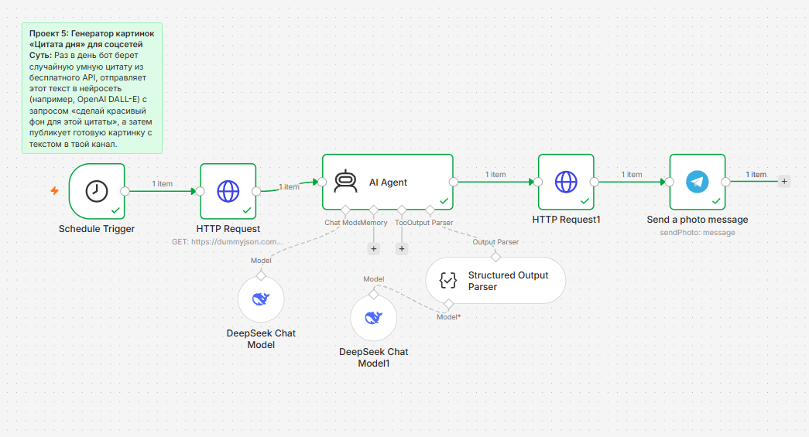

# 🖼️ Генератор картинок «Цитата дня» для соцсетей

Автоматизированный сценарий для n8n, который ежедневно получает случайную цитату через API, выполняет перевод и смысловой разбор с помощью DeepSeek, генерирует контекстное фоновое изображение через Pollinations AI и публикует готовый пост в Telegram-канал. Решение полностью устраняет ручной труд по подбору, оформлению и публикации ежедневных вдохновляющих заметок.


---

### Ключевые возможности

* **Автономное расписание:** Регулярный ежедневный триггер в 07:00 без необходимости ручного перезапуска.
* **Строгая типизация и валидация:** Использование `Structured Output Parser` с механизмом `autoFix` гарантирует получение валидного JSON с предсказуемыми полями (`russian_quote`, `author`, `meaning`, `visual_prompt`).
* **Контекстная генерация визуала:** AI Agent создает детализированный англоязычный промпт сцены без текста и артефактов специально под настроение мысли.
* **Бесшовный пайплайн бинарных данных:** Загрузка изображения из Pollinations AI в виде бинарного файла напрямую в память сценария и отправка через метод `sendPhoto` Telegram Bot API.
* **Типографика и верстка:** Автоматическое форматирование цитаты в HTML-теги `<blockquote>`, выделение автора и добавление смыслового разбора в единую подпись.

---

### Архитектура и стек

* **Оркестрация:** n8n (версия с поддержкой LangChain-нод)
* **Источник цитат:** DummyJSON API (`https://dummyjson.com/quotes/random`)
* **LLM / Анализ текста:** DeepSeek Chat (`deepseek-chat`) через `@n8n/n8n-nodes-langchain`
* **Генерация изображений:** Pollinations AI REST API (`image.pollinations.ai`)
* **Транспорт и доставка:** Telegram Bot API (`sendPhoto`)



```text
[ Schedule Trigger (07:00) ]
              │
              ▼
    [ HTTP Request ] ────> Запрос случайной цитаты (DummyJSON)
              │
              ▼
        [ AI Agent ] <───> [ DeepSeek Chat Model ]
              │      <───> [ Structured Output Parser ] ──> [ DeepSeek Chat Model1 (autoFix) ]
              │
              ▼ (JSON: russian_quote, author, meaning, visual_prompt)
    [ HTTP Request1 ] ───> Генерация фона (image.pollinations.ai) -> binary file
              │
              ▼
[ Send a photo message ] ─> Публикация фото + HTML-подпись в Telegram-канал
```

---

### Быстрый старт и установка

#### Предварительные требования
1. Развернутый экземпляр n8n (Cloud или Self-Hosted).
2. API-ключ от платформы **DeepSeek** (`platform.deepseek.com`)
3. Токен Telegram-бота от `@BotFather` и ID целевого канала (`Chat ID` вида `-100xxxxxxxxxx` или `@channel_name`)
4. Бот должен быть добавлен в администраторы канала с правом публикации сообщений

#### Пошаговый запуск

1. **Импорт сценария:** Скопируйте содержимое файла сценария `workflow.json` и импортируйте его в n8n через интерфейс (`Import from File` или `Import from Clipboard`).
2. **Настройка DeepSeek:**
   * Откройте ноду `DeepSeek Chat Model` и добавьте ваши учетные данные `DeepSeek API`.
   * Откройте ноду `DeepSeek Chat Model1` (привязана к парсеру) и выберите ту же учетную запись.
3. **Настройка Telegram:**
   * В ноде `Send a photo message` укажите созданные учетные данные `Telegram API`.
   * В поле `Chat ID` замените `YOUR_TELEGRAM_CHAT_ID` на ID вашего канала.
4. **Проверка триггера и активация:**
   * Проверьте часовой пояс в ноде `Schedule Trigger` (по умолчанию установлен запуск в 07:00).
   * Переключите тумблер сценария в положение **Active**.

---

### Обработка краевых случаев

| Сценарий | Поведение системы | Результат |
| :--- | :--- | :--- |
| LLM возвращает markdown-обертку или битый JSON | Срабатывает нода `Structured Output Parser` с активным флагом `autoFix` через `DeepSeek Chat Model1` | Исправление схемы на лету, сценарий не падает |
| Недоступность внешнего API цитат (DummyJSON) | HTTP Request завершается статус-кодом `5xx`/`4xx` | Остановка выполнения цепочки на первом шаге без расхода токенов LLM |
| Спецсимволы и пробелы в промпте для картинки| Значение экранируется выражением `encodeURIComponent($json.output.visual_prompt)` | Корректный URL-запрос к API генерации изображений без разрывов строки |
| Бот не имеет прав на публикацию в канале | Telegram API возвращает ошибку `403 Forbidden` | Регистрация ошибки в логах выполнения n8n для аудита администратором|

---

### Метрики эффективности

| Параметр | Значение | Примечание |
| :--- | :--- | :--- |
| Среднее время выполнения | 6–10 секунд | Зависит от генерации ответа LLM и рендеринга изображения |
| Себестоимость запроса | ~$0.0002 | Расход токенов на базе тарифов модели `deepseek-chat` (генерация изображений Pollinations бесплатна)|
| Потребление ресурсов n8n | Минимальное | Изображение передается через бинарный поток без сохранения на диск сервера |
| Частота публикации | 1 раз в сутки | Настраивается через `Schedule Trigger` |

---

### Контакты

* **Автор:** Kodzhi Tanaka
* **Telegram:** [@TanakaKodzhi](https://t.me/TanakaKodzhi)
* **Telegram-канал о разработке и автоматизациях:** [Build -> Запуск](https://t.me/tanaka_dev)
